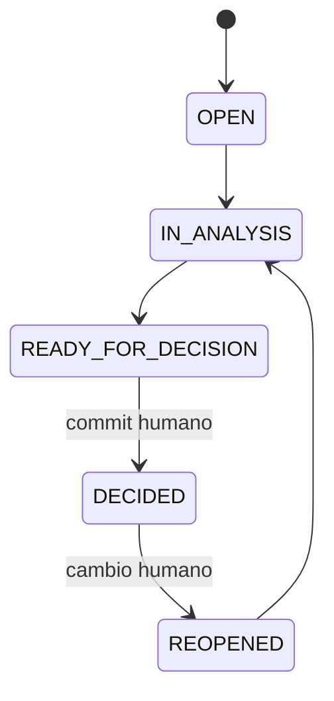
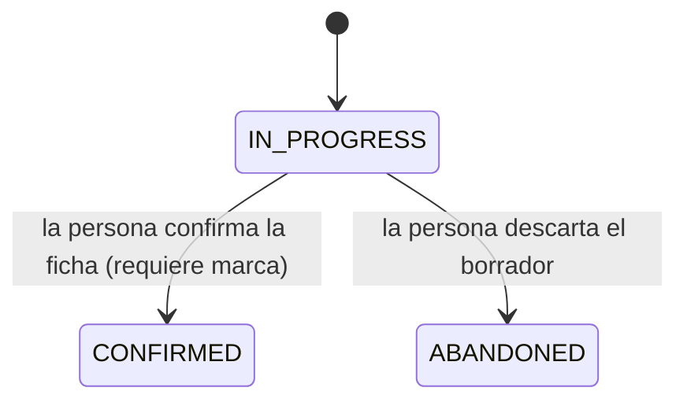
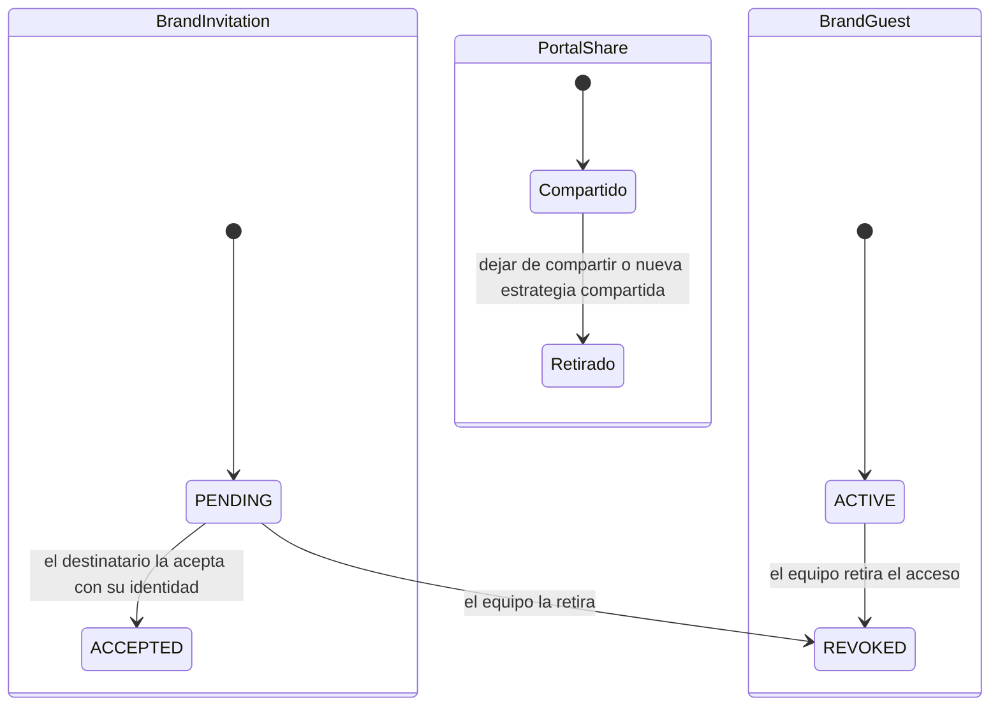
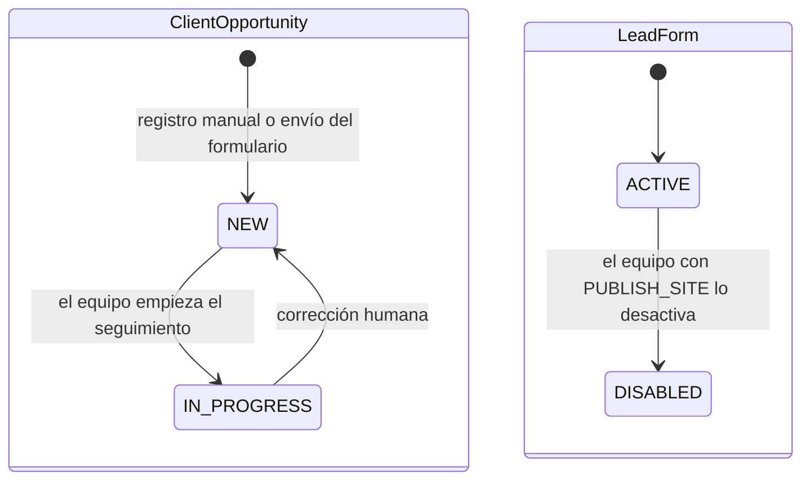

Status: canonical
Owner: Product / Engineering
Canonical: yes
Last reviewed: 2026-09-24
Related: docs/00-index/source-of-truth.md
Depends on: Master Context v1.0 + hardening brief 2026-09-24

# State Machines v1

| Objeto | Estados aprobados | Evento y actor |
|---|---|---|
| StrategicQuestion | OPEN → IN_ANALYSIS → READY_FOR_DECISION → DECIDED; DECIDED → REOPENED → IN_ANALYSIS | análisis abre User; readiness por validación; commit humano decide; reapertura humana |
| Hypothesis | UNTESTED → TESTING → SUPPORTED / WEAKENED / REJECTED; SUPPORTED / WEAKENED → TESTING (nuevo ciclo, ADR-0026); REJECTED final | sólo revisión humana con criterio; no evidencia implica UNTESTED; un nuevo ciclo exige aprendizaje aceptado después de reabrirlo |
| Experiment | PLANNED → RUNNING → COMPLETED / INCONCLUSIVE / CANCELLED; PLANNED → CANCELLED | User inicia y cierra; cancelación previa explícitamente autorizada en continuación 2026-09-24; falta señal concluyente → INCONCLUSIVE |
| BrandDomainHealth | OPEN / PARTIAL / COMPLETE / NEEDS_REVIEW | proyección derivada del conjunto de Decisions/questions; NEEDS_REVIEW domina |
| Recommendation | GENERATED → ACCEPTED / MODIFIED / REJECTED / STALE | User resuelve; cambio de contexto marca stale |
| Decision | APPROVED / MODIFIED / REJECTED / NEEDS_REVIEW / INVALIDATED | MODIFIED/REJECTED describen resultado de acción humana; NEEDS_REVIEW no cambia elección; INVALIDATED sólo humano |
| DecisionVersion | APPROVED → SUPERSEDED | commit humano crea versión nueva; anterior sigue consultable |
| ReviewItem | OPEN / REVIEW_SUGGESTED / COMPLETED | HARD → OPEN y Decision NEEDS_REVIEW; SOFT puede sugerir; revisión humana completa |
| Learning | CANDIDATE → REVIEWED → ACCEPTED / REJECTED | sólo humano convierte interpretación en aprendizaje |
| EditorialVersion | DRAFT → IN_REVIEW → CHANGES_REQUESTED / APPROVED; APPROVED → SUPERSEDED | ADR-0030 · versión inmutable al salir de DRAFT; SUPERSEDED sólo cuando otra versión posterior es aprobada; punteros borrador/aprobada/publicada separados |
| PlanAction | PLANNED → IN_PROGRESS → DONE; PLANNED / IN_PROGRESS → CANCELLED | ADR-0030 / PHASE4_SPEC §4.2 · editar no cambia el estado; hecha o cancelada es de sólo lectura; cada cambio sube la revisión del registro y añade una entrada a `plan_changes` (append-only) |
| BrandKitVersion | igual que EditorialVersion | ADR-0034 · un kit por marca con punteros borrador / aprobada / publicada; entradas INGEST, COMPLETE y CREATE; cada valor con certeza DECLARED / ESTIMATED / PROPOSED / CONFIRMED (CONFIRMED sólo por adopción explícita registrada); aprobar no publica; publicar exige `PUBLISH_BRAND_KIT` (`brand_kit_publications`, append-only); archivos `kit_assets` append-only, formato por firma |
| DeliverableVersion | igual que EditorialVersion | ADR-0030 / PHASE4_SPEC §4.4 · cinco tipos; manifiesto de origen (versiones de decisión, versión aprobada de la oferta, kit pendiente) y procedencia `MANUAL` / `AI_ASSISTED` decididos por el servidor; decisión idempotente en `deliverable_approvals` (append-only); registro manual de publicación (`deliverable_publications`, append-only) sólo para la versión aprobada de una publicación social; nunca se publica desde Brandopolis |
| PlanSnapshot | IN_REVIEW → APPROVED / CHANGES_REQUESTED; APPROVED → SUPERSEDED (al aprobar una posterior) | PLN-001…003 · copia fija del plan; aprobación sobre versión + huella exactas con criterio y clave (`plan_snapshot_approvals` append-only); el cliente ve sólo la aprobada; el avance (`plan_progress_updates`, append-only) se registra al cambiar el estado de una acción incluida y no exige nueva aprobación |
| PlanObjective | ACTIVE → ARCHIVED (por edición con revisión) | horizonte ANNUAL o NINETY_DAYS; archivar conserva las acciones vinculadas |
| OperationAuthorization | PENDING → AUTHORIZED → RESERVED → CONSUMED; PENDING / AUTHORIZED / RESERVED → CANCELLED / EXPIRED | ADR-0031 · humano con AUTHORIZE_SPEND confirma; un solo trabajo la reserva; la reserva no amplía el plazo |
| ExternalJob | QUEUED → CLAIMED → RUNNING → SUCCEEDED / FAILED / NEEDS_CHECK / PARTIAL / EXPIRED; QUEUED / CLAIMED → CANCELLED | ADR-0031 · worker con concesión persistida; incierto nunca se reenvía solo |
| ExternalStep | PENDING → DISPATCHING → SUCCEEDED / REJECTED / NEEDS_CHECK; NEEDS_CHECK → SUCCEEDED / NOT_CREATED; REJECTED / NOT_CREATED → DISPATCHING | ADR-0031 C1 · DISPATCHING confirmado es el inicio del intento; NOT_CREATED sólo con evidencia remota tras evidencia de que el intento no puede emitir; repetición humana con autorización vigente |

**Assumption in Use es relación/flag de uso de una Hypothesis por una Decision vigente, jamás status de Hypothesis.** Decision.ReviewStatus y DecisionVersion.VersionStatus tienen enums separados para no mezclar decisión, acción y versión. `REJECTED` de Recommendation no crea Decision; `REJECTED` de una propuesta Decision registra acción humana, no versión aprobada. `SUPERSEDED` sólo corresponde a versión. `INVALIDATED` exige acto humano auditado. `BrandDomainHealth` técnica que indique `IN_PROGRESS` se mapea a PARTIAL; `NOT_STARTED` se mapea a OPEN; `CURRENT` a COMPLETE sólo si no faltan decisiones requeridas ni reviews.

## BrandSetupDraft (PHASE4_SPEC §4.10 · inicio guiado)

Borrador del inicio guiado de su autor, dentro de su workspace. Se liga una sola vez a la marca al crearla
(idempotente). Un borrador abierto por persona sin marca y uno por marca. Confirmar registra contexto declarado
(sólo lo que difiere del vigente) y la geografía; no crea versiones de decisiones ni aprueba estrategia, kit o plan.
Un borrador cerrado es inmutable (trigger); cada guardado avanza la versión en uno (409 si la pantalla es antigua).

## BrandInvitation, BrandGuest y PortalShare (ADR-0033 · colaboración)

Una invitación a una sola marca, con token de un solo uso guardado como hash y caducidad de 7 días (`EXPIRED` se
deriva de la fecha; nunca se guarda). La entrega es por enlace mientras no haya proveedor de email. Un invitado lo es
de una sola marca. Lo compartido apunta a una versión exacta (huella); sólo cambia por su retirada. Comentarios y
aprobaciones del portal son append-only. Las transiciones están protegidas por triggers (migración 0026).

## ClientOpportunity y LeadForm (ADR-0035 · Clientes, Fase 4)

Una oportunidad registrada a mano o por el formulario web de la marca. `NEW` (Nueva) y `IN_PROGRESS` (En
seguimiento) no significan venta, conversión de un proveedor ni aprobación estratégica. Responsable y seguimiento
son atributos, no estados: sin responsable = cola «Por asignar»; sin fecha = «Sin seguimiento»; fecha pasada =
«Seguimiento vencido» (derivado, nunca guardado). Cada cambio sube la revisión en uno (409 ante revisión antigua) y
añade un evento append-only. El cierre ganado/perdido es contrato de la Fase 5 (PHASE4_SPEC §12.6). Un formulario se
desactiva una sola vez. Las interacciones (evidencia de origen) y los eventos son append-only. Triggers en la
migración 0027.

