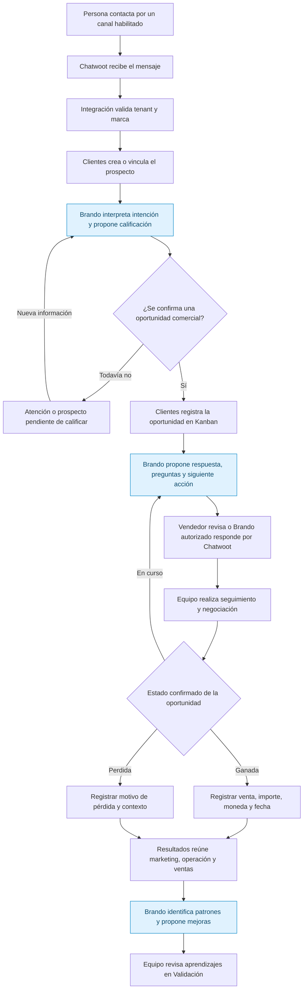

# Brandopolis · Clientes y Resultados comerciales
Fecha: 11 de octubre de 2026 · America/Mexico_City
Estado: decisiones de producto y flujo comercial inteligente aprobados por el propietario; implementación pendiente.
Alcance de esta actualización: planificación y continuidad de la próxima iteración.
Versión 5: añade múltiples asesores y segmentos, metas globales y por segmento/producto/servicio/asesor en mes/trimestre/año, históricos comparativos y forecast de negocios ganados. Conserva el flujo multicanal, la trazabilidad campaña-venta y la entrega por Fases 4/5/6. Implementación pendiente.

## 1. Decisión aprobada

Brandopolis incorporará un módulo comercial propio, integrado con su estrategia y marketing, con separación por tenant y marca y funciones para equipos. Su nombre visible en navegación será **Clientes**. «CRM» puede utilizarse como descripción técnica interna.

**Resultados** abarcará tres dimensiones: marketing, operación comercial y ventas. Esta adición debe incorporarse desde la próxima iteración para conservar y dar seguimiento a las oportunidades que genere Brandopolis.

Instrucción del propietario:
> incorpora esta adición a nuestros planes. Considero que en el menú no debería llamarse CRM sino algo así como Clientes. En resultados ya no solo se incluiran dashboards de kpis de marketing referentes a sitio web, campañas, sino a la operación y a los resultados de ventas. En tu próxima iteración ya deberías incorporarlo para no perder oportunidades.

La aprobación confirma el desarrollo propio y la ampliación de producto. No selecciona automáticamente un repositorio, proveedor de mensajería, infraestructura nueva o precio.

## 2. Ubicación y próxima iteración

Se conserva el roadmap general de seis macrofases y el trabajo ya aprobado.

| Etapa | Incorporación |
|---|---|
| Próxima iteración de planificación/desarrollo, dentro de la Fase 4 en curso | Reconciliar esta decisión con la especificación más reciente; incorporar Clientes en navegación y diseño; ampliar Resultados; priorizar una captura inicial persistente de oportunidades por tenant y marca, con origen, responsable y siguiente seguimiento. |
| Fase 5 · Measurement & Intelligence | Desarrollar el núcleo comercial de Clientes junto con la medición ya prevista: contactos, empresas, oportunidades, Kanban, tareas, responsables, metas, mensajería inicial, Brando como asistente del vendedor y dashboards comerciales. |
| Fase 6 · Agentic Scale | Ampliar conectores, automatizaciones y atención automática de Brando por marca/canal, con permisos, auditoría y límites de actuación. |

La captura inicial es un adelanto acotado para evitar perder oportunidades; no equivale a adelantar todo el CRM de Fase 5. Debe resolverse en la próxima especificación, con esfuerzo y pruebas explícitos, y no quedar omitida porque documentos anteriores excluían el CRM.

Si Clientes se muestra activo, debe permitir una acción real y persistente. Una maqueta, un contador ilustrativo o «Próximamente» no cumplen el objetivo de captación.

## 3. Clientes · alcance de producto

- Contactos y empresas: datos básicos, etiquetas, responsable, origen e historial; importación y exportación autorizadas.
- Prospectos y oportunidades: relación con una oferta, estado, importe, moneda, fecha esperada, responsable y motivo de pérdida.
- Kanban: etapas editables y trazabilidad de movimientos.
- Equipos: asignaciones, tareas, recordatorios, notas internas y traspasos.
- Metas: objetivos globales por marca y por equipo, segmento, producto, servicio y asesor, medidos mensual, trimestral y anualmente; históricos comparables y forecast de negocios ganados conforme a la sección 13.
- Conversaciones: bandeja y relación verificable entre conversación, contacto y oportunidad.
- Fuentes objetivo: website, formularios de Meta, TikTok y LinkedIn, correo y canales de mensajería pertinentes.
- Brando: consulta, resumen, priorización y propuestas de seguimiento utilizando información permitida de la marca activa.

Se distingue captación por formulario de mensajería: una integración de Lead Gen Forms no acredita acceso a mensajes privados. Los conectores deben documentar disponibilidad, autorizaciones y estado de conexión.

El núcleo comercial debe relacionarse con las ofertas, públicos y campañas de Brandopolis. No se crea un segundo sistema estratégico ni se altera una decisión aprobada automáticamente.

## 4. Resultados · alcance ampliado

Resultados conserva su etiqueta y ofrece vistas accesibles para tres dimensiones.

| Dimensión | Indicadores previstos |
|---|---|
| Marketing | Sitio web, campañas, inversión, solicitudes, leads calificados y conversiones con fuente y definición verificables. |
| Operación comercial | Prospectos sin asignar, primera respuesta, seguimiento pendiente o vencido, carga por responsable, oportunidades por etapa y tiempo entre etapas. |
| Ventas | Oportunidades ganadas/perdidas, tasa de cierre, valor de ventas ganadas, ticket promedio, ciclo comercial, motivos de pérdida y avance de metas. |

Ingresos facturados y cobrados se mostrarán únicamente cuando exista una fuente o registro verificable. El valor esperado del embudo y el pronóstico se presentan como estimaciones, separados de ventas ganadas, facturación y cobros.

Cada indicador debe indicar periodo, moneda cuando corresponda, fuente y última actualización. «Sin datos» se distingue de cero. No duplicar conversiones ni atribuir causalidad a una campaña sin evidencia suficiente.

La comparación entre marcas sólo se permite a usuarios autorizados y debe respetar moneda, periodo y definiciones de cada métrica.

## 5. Tenant, marca y permisos

Reutilizar y extender el modelo existente de workspace/marca, identidad, autorización, auditoría, concurrencia e idempotencia. Antes de implementar, comprobar su estado en el código real.

Todo registro comercial debe tener propietario y ámbito definidos. El servidor determina y valida el contexto del tenant y la marca; no confía en un selector o identificador enviado por el navegador.

La separación cubre consultas, mutaciones, deduplicación, búsquedas, exportaciones, adjuntos, mensajes, credenciales, trabajos en segundo plano, cachés y contexto de IA. No mezclar registros de tenants ni de marcas por coincidir un correo o teléfono.

Definir la titularidad de los datos y el acceso delegado de agencias antes de habilitar operación entre clientes independientes. Una vista de agencia reúne sólo marcas autorizadas.

El cliente invitado que consulta, comenta y aprueba marketing no obtiene por ello permisos de vendedor. Los permisos comerciales son explícitos.

## 6. Captura inicial · aceptación de la próxima iteración

1. Existe un destino Clientes integrado con el selector de marca y la navegación vigente, sin romper el comportamiento de los laterales.
2. Una oportunidad puede registrarse manualmente y la captura desde un formulario web tiene una ruta definida y comprobada.
3. El registro persiste con marca, origen, fecha, responsable o cola de asignación, y estado inicial.
4. Una oportunidad sin seguimiento aparece como pendiente accionable, con acceso autorizado al registro.
5. Un reintento del formulario o webhook no crea registros duplicados del mismo evento.
6. Las pruebas cubren acceso entre tenants, marcas y roles, incluidos archivos, búsquedas y exportaciones cuando existan.
7. Los resultados iniciales distinguen datos reales de ausencia de conexión; no simulan ventas ni integración activa.
8. Las fuentes no habilitadas se identifican por su estado real, con explicación de requisitos pendientes.
9. La evidencia comercial puede alimentar el motor de Validación con procedencia y revisión humana; no aprueba aprendizajes ni reescribe estrategia.
10. La entrega incluye estado de implementación, pruebas realmente ejecutadas, limitaciones y continuidad de Fases 5 y 6.

## 7. Opciones técnicas y economía

La experiencia, identidad y modelo comercial pertenecerán a Brandopolis. Atomic CRM puede evaluarse para reutilizar componentes; Chatwoot puede evaluarse como motor de conversaciones. Ambos son candidatos, no decisiones de adopción.

No introducir React, Supabase, otro servicio o infraestructura adicional sólo por elegir un repositorio de referencia. Justificar la necesidad y compatibilidad con la arquitectura vigente.

El objetivo comercial es ofrecer una opción accesible para pymes. Mantener Marca Activa como referencia de planificación y evaluar usuarios incluidos y límites de consumo. Cualquier cambio de precio requiere costes medidos y una decisión posterior.

Desarrollo propio conserva costes de mantenimiento, soporte, almacenamiento, mensajería e IA. No prometer ahorro frente a un CRM externo sin calcular el coste total.

## 8. Continuidad y reconciliación documental

En la próxima iteración actualizar conjuntamente la especificación de fase, matriz de aceptación, requisitos externos, registro de alcance diferido, roadmap, handoff, SESSION_STATE y CHANGELOG.

La frase histórica «CRM diferido» se mantiene como registro de la situación anterior, acompañada de esta resolución de producto. No debe seguir utilizándose para excluir Clientes del plan futuro.

Referencias consultadas:
- Especificación v4 de Fase 4, del 10 de octubre de 2026, contenida en brandopolis-phase4-spec-review-v4-2026-10-10.zip.
- Roadmap general: Fase 4 Activation & Orchestration; Fase 5 Measurement & Intelligence; Fase 6 Agentic Scale.
- Repositorio Vik-Avila/brandopolis: main consultado en esta actualización conserva el cierre de Fase 3 y no contiene PHASE4_SPEC.md. No debe utilizarse esa ausencia para sobrescribir documentación local posterior.

Esta entrega registra planificación aprobada. No acredita una interfaz implementada, integraciones conectadas, pruebas funcionales aprobadas o despliegue. Las operaciones externas concretas conservan sus autorizaciones aplicables.

Registro de ejecución y continuidad: [Issue #10 · Clientes y Resultados comerciales](https://github.com/Vik-Avila/brandopolis/issues/10).

## 9. Hallazgos de Atomic y Chatwoot para el desarrollo

Actualización del 11 de octubre de 2026, solicitada por el propietario para que el equipo del otro chat del proyecto la considere desde su próxima interacción.

Instrucción del propietario:
> integra estos descubrimientos en el desarrollo para que sean considerados desde la próxima interaccion que no ocurre en este chat sino en otro del proyecto

### 9.1 Estado y dirección técnica

Es obligatorio incorporar estos hallazgos a la próxima revisión de especificación e implementación. La dirección recomendada es **Clientes nativo de Brandopolis + Chatwoot como servicio conversacional + reutilización selectiva de Atomic**. La incorporación de los hallazgos no acredita selección definitiva de dependencias, una integración terminada ni autorización para compras o despliegue.

Atomic y Chatwoot siguen siendo candidatos. La selección se resolverá mediante una prueba acotada, revisión de licencia de la versión elegida, compatibilidad con el código vigente y coste total de operación.

### 9.2 Experiencia propia y responsabilidad de datos

La captura de Atomic revisada muestra una demo con API simulada y datos que se reinician al recargar; no demuestra persistencia productiva ni aislamiento por tenant/marca. Atomic tiene licencia MIT y utiliza React, shadcn y Supabase. Sus patrones de contactos, empresas, tareas y Kanban son referencias útiles. Reutilizar componentes exige adaptación; no importar automáticamente su aplicación, identidad o backend.

Mantener el diseño, navegación, selector de marca, lenguaje y permisos de Brandopolis. Conservar el comportamiento aprobado de laterales colapsables y la visibilidad de Brando.

| Área | Responsabilidad propuesta |
|---|---|
| Clientes de Brandopolis | Registro comercial principal: contactos, empresas, oportunidades, etapas, tareas, responsables, metas y relación con ofertas/campañas. |
| Chatwoot, si se adopta | Registro de conversaciones y mensajes, conexión de canales, adjuntos y operación de la atención. |
| Integración de Brandopolis | Correspondencia de identidades externas, contexto tenant/marca, autorización y sincronización controlada de los campos necesarios. |
| Resultados | Medición conjunta de marketing, operación comercial y ventas con procedencia verificable. |
| Brando | Resúmenes y propuestas de seguimiento dentro del ámbito autorizado, con actuación humana conforme a los contratos vigentes. |

Definir qué sistema gobierna cada campo compartido y cómo se resuelven cambios. Evitar dos expedientes comerciales editables sin autoridad definida. Mantener referencias verificables entre contacto, conversación y oportunidad; no unir automáticamente identidades de diferentes canales sólo por similitud de nombre o coincidencia de teléfono/correo.

Vista conversacional propuesta dentro de Clientes: lista de conversaciones, intercambio y ficha contextual del contacto/oportunidad. Evaluar responder, notas internas, asignación y siguiente seguimiento desde la misma experiencia. Esto es una propuesta de diseño; todavía no es una vista aprobada ni implementada.

### 9.3 Integración por API y eventos

Chatwoot documenta Application APIs para operaciones de agentes, Client APIs para experiencias del cliente final y Platform APIs para administrar cuentas/usuarios en instalaciones propias. La bandeja del vendedor debe utilizar las APIs de agente adecuadas; un widget o las Client APIs no equivalen a una bandeja operativa completa.

Las Platform APIs están disponibles en Self-hosted/Managed Hosting y restringen el acceso a recursos creados por su clave o explícitamente autorizados. Planificar el aprovisionamiento con esta limitación. No confundirlo con la función comercial SSO/SAML.

El adaptador de Brandopolis debe:
- Mantener las credenciales de servicio en el servidor y validar usuario, tenant, marca y recurso para cada operación.
- Registrar la correspondencia de cuenta, inbox, contacto, conversación y usuario externos con las entidades propias.
- Recibir y verificar webhooks según la versión elegida; registrar procedencia, prevenir duplicados, controlar reintentos y reconciliar eventos faltantes o fuera de orden.
- Distinguir mensajes entrantes/salientes de notas privadas, así como estado de entrega y fallos.
- Separar la resolución de una conversación del cierre ganado de una oportunidad.
- Evitar que una desconexión de Chatwoot impida conservar una oportunidad o seguimiento en el núcleo comercial.
- Revisar baja de usuarios, cambio de membresía, retención, exportación, eliminación y acceso a adjuntos.

El API permite integrar capacidades, pero cada función expuesta en Brandopolis requiere diseño y validación. Las nuevas funciones de Chatwoot no aparecerán automáticamente en nuestra interfaz. Evaluar la cobertura frente a la interfaz operativa completa antes de prometer equivalencia.

Priorizar el adaptador y mantener pocos cambios sobre Chatwoot. Si se requiere modificar su interfaz o código, documentar la carga de mantenimiento y actualización. El uso de iframe sólo puede decidirse después de probar autenticación, restricciones de navegación, permisos y experiencia en la versión instalada.

### 9.4 Aislamiento por tenant y marca

Una cuenta de Chatwoot por marca dentro de cada tenant es una **hipótesis de diseño por validar**, no un contrato decidido. Compararla con otras estructuras mediante pruebas de permisos, operación de agencias y coste.

Una cuenta compartida con distintos inboxes no debe aceptarse como equivalente a aislamiento por marca sin comprobar contactos, búsqueda, informes, exportaciones, adjuntos, notas y APIs. Tampoco una cuenta por marca sustituye las validaciones del servidor de Brandopolis.

Las pruebas deben cubrir cruces entre tenants, entre marcas del mismo tenant y entre roles; usar identificadores manipulados, enlaces de archivos y eventos recibidos. El acceso delegado de agencia sólo reúne marcas autorizadas. Los permisos de invitado de marketing no se convierten automáticamente en permisos comerciales.

### 9.5 Open source, capacidades comerciales y costes

Hechos comprobados en fuentes oficiales el 11 de octubre de 2026:
- Chatwoot Community Edition tiene núcleo MIT; permite uso comercial, modificación e incorporación en otro producto, conservando avisos de copyright/licencia y respetando licencias de terceros.
- La carpeta enterprise tiene licencia separada. Uso productivo, número de usuarios y cualquier integración o distribución comercial deben ajustarse al acuerdo aplicable. Código público no equivale a permiso MIT.
- La tabla actual de planes self-hosted sitúa Captain AI, llamadas de voz, personalización configurable de marca, capacidad de agentes y permisos avanzados en planes de pago; SSO/SAML y SLA en Enterprise. Revalidar la matriz sobre la versión y contrato elegidos.
- La FAQ oficial permite personalizar la marca de Community modificando el código. Distinguir esa posibilidad de la función configurable comercial. Una interfaz propia sobre APIs no exige copiar código Enterprise.
- La FAQ permite interfaces conversacionales e integración en software existente. Su recomendación de no crear clones competidores no sustituye las condiciones de la licencia MIT; revisar separadamente términos y marcas aplicables.
- Brando puede evaluarse como asistente propio usando información permitida de las conversaciones; no asumir que esto incluye Captain AI ni reutilizar su código comercial.
- Self-hosted requiere servidores web, workers, PostgreSQL, Redis, correo y almacenamiento de archivos, además de actualizaciones, respaldo y soporte. Justificar cualquier nueva infraestructura mediante las decisiones de arquitectura del proyecto.

No afirmar que tendremos gratis todo el potencial de Chatwoot. Definir una matriz de funciones con disponibilidad en Community/planes comerciales, soporte API, restricciones por canal, trabajo de integración y coste. Los costes de canales/proveedores, almacenamiento e IA permanecen aunque el núcleo sea MIT.

### 9.6 Canales y captación

Chatwoot documenta canales como web, correo, WhatsApp, Facebook, Instagram y TikTok. Esto no acredita que todas las cuentas de cada cliente sean elegibles ni que todos los formatos y acciones estén soportados en cada canal.

- TikTok requiere cuentas Business elegibles y aprobaciones/configuración correspondientes, con restricciones regionales y operativas.
- LinkedIn Lead Sync requiere acceso aprobado; captación de formularios no acredita acceso a mensajes privados.
- Formularios de Meta/TikTok/LinkedIn y campañas son flujos de captación distintos de las conversaciones de sus redes.
- Crear una matriz de fuentes: capacidades, requisitos, responsable de configuración, estado real, pruebas ejecutadas y limitaciones.
- Conservar el origen conocido y separar atribución demostrada, estimaciones y ausencia de datos.

### 9.7 Verificación acotada y roadmap

La próxima interacción debe incorporar estos requisitos al diseño y a la especificación vigentes y programar una prueba de compatibilidad de Chatwoot. La captura manual/web ya aprobada no debe depender de tener todos los canales conectados.

Prueba propuesta: mensaje web -> contacto relacionado -> oportunidad y seguimiento persistentes, con un reintento sin duplicados y dos marcas con pruebas negativas de acceso. Cuando exista el núcleo de ventas, extender hasta venta ganada y Resultados; no adelantar el CRM completo sólo por esta prueba.

Mantener Fase 4 para el adelanto acotado de captura y reconciliación; Fase 5 para núcleo comercial y mensajería inicial; Fase 6 para ampliación de conectores y automatizaciones. Ajustar el esfuerzo con evidencia sin omitir el alcance original de cada macrofase.

Aceptación adicional:
- [ ] Incorporar la matriz de capacidades, licencia y costes al análisis de dependencias.
- [ ] Resolver y documentar autoridad de datos, correspondencia de identidades y aislamiento por tenant/marca.
- [ ] Actualizar especificación, matriz de aceptación, requisitos externos, roadmap, alcance diferido y handoff.
- [ ] Registrar la decisión de arquitectura antes de incorporar servicios/frameworks nuevos.
- [ ] Documentar pruebas ejecutadas, cobertura API real y limitaciones; no declarar canales activos ni equivalencia total por una demo.
- [ ] Registrar la continuidad en SESSION_STATE y CHANGELOG del checkout vigente.

### 9.8 Fuentes oficiales para el siguiente desarrollador

Consultar nuevamente la licencia, documentación y versión elegidas antes de integrar:
- [Atomic CRM: repositorio, arquitectura, funciones y licencia](https://github.com/marmelab/atomic-crm).
- [Chatwoot: licencia principal](https://github.com/chatwoot/chatwoot/blob/develop/LICENSE).
- [Chatwoot: licencia Enterprise](https://github.com/chatwoot/chatwoot/blob/develop/enterprise/LICENSE).
- [Chatwoot: APIs y límites de Platform APIs](https://developers.chatwoot.com/api-reference/introduction).
- [Chatwoot: webhooks](https://developers.chatwoot.com/api-reference/webhooks/add-a-webhook).
- [Chatwoot: planes self-hosted](https://www.chatwoot.com/pricing/self-hosted-plans).
- [Chatwoot: FAQ de SaaS y personalización](https://developers.chatwoot.com/self-hosted/faq).
- [Chatwoot: arquitectura de producción](https://developers.chatwoot.com/self-hosted/deployment/architecture).
- [Chatwoot: capacidades por canal](https://developers.chatwoot.com/self-hosted/supported-features).
- [Chatwoot: configuración de TikTok](https://developers.chatwoot.com/self-hosted/configuration/features/integrations/tiktok).
- [LinkedIn: Lead Sync](https://learn.microsoft.com/en-us/linkedin/marketing/lead-sync/leadsync-overview).

## 10. Instrucción de continuidad para el otro chat del proyecto

Leer esta actualización completa, incluida la sección 11 del flujo aprobado, y la [issue #10](https://github.com/Vik-Avila/brandopolis/issues/10) antes del siguiente bloque de desarrollo. Reconciliar con el checkout/branch y documentación más recientes; no sobrescribir el trabajo de Fase 4 por consultar una versión anterior de main.

Aplicar las instrucciones vigentes del repositorio y las skills pertinentes. Integrar Clientes y Resultados ampliados en la especificación y aceptación de la fase, con captura persistente inicial. Considerar Clientes nativo, Atomic selectivo y Chatwoot por APIs/eventos como dirección recomendada por validar, con permisos tenant/marca, licencia Community vs Enterprise, costes y cobertura real de funciones. Conservar autoridad humana, diseño aprobado y seis macrofases.

La decisión de producto está aprobada; la adopción de dependencias y la prueba siguen pendientes. Informar qué se incorpora al código y documentos, qué se valida y qué queda pendiente, sin presentar planificación como implementación.

Este documento y la issue son el traspaso durable. No se ha enviado un mensaje al otro chat ni modificado su sesión, código o despliegue desde esta conversación.

## 11. Flujo comercial inteligente · alcance aprobado antes del siguiente bloque de Claude

Fecha de incorporación: 11 de octubre de 2026. Esta sección amplía las secciones 3, 6, 9 y 10. La dirección funcional deja de ser sólo una ilustración: debe incluirse en el alcance del proyecto y reconciliarse antes de comunicar el siguiente bloque de desarrollo.

Instrucción del propietario:
> este esquema ya está incluido en nuestro alcance de proyecto? Si aún no, debes integrarlo antes de que comunique a claude el siguiente bloque

### 11.1 Resolución de alcance

Se incorpora el recorrido **conversación de WhatsApp -> prospecto -> oportunidad -> seguimiento y negociación -> cierre ganado o perdido -> Resultados -> propuesta de aprendizaje -> revisión humana en Validación**, con inteligencia de Brando durante el proceso.

El alcance funcional está aprobado. El diagrama utiliza Chatwoot como motor conversacional de referencia; su adopción y despliegue requieren validar versión, licencia, compatibilidad, costes y permisos. Atomic sigue siendo una alternativa de reutilización selectiva o núcleo por evaluar. Clientes es el módulo propio visible del producto y la autoridad comercial debe quedar definida aunque se reutilice Atomic.

La incorporación al alcance no acredita que estos pasos estén implementados ni activos con proveedores reales. No autoriza una compra, envío de mensajes a clientes o despliegue de producción.

### 11.2 Diagrama de referencia aprobado

El diagrama representa la experiencia objetivo. Las habilitaciones y límites de cada macrofase se describen en 11.5. «Brando autorizado responde» sólo aplica a una marca/canal con política de actuación habilitada y validada.

### 11.3 Inteligencia propia de Brando y operación conversacional

| Momento | Capacidad incluida en el alcance | Autoridad y condición |
|---|---|---|
| Captación | Interpretar la consulta, proponer calificación, identificar datos faltantes y consultar oferta vigente. | Contexto limitado al tenant/marca; distinguir un contacto de una oportunidad. |
| Atención y seguimiento | Resumir conversación, preparar respuestas, proponer preguntas, tareas y siguiente acción; señalar seguimientos vencidos. | Primero como asistente del vendedor con revisión humana. |
| Atención automática | Responder preguntas permitidas y recopilar información comercial; transferir a una persona cuando sea necesario o se solicite. | Agente externo por marca/canal, habilitado explícitamente y sujeto a pruebas; ampliar en Fase 6. |
| Cierre | Proponer resumen del acuerdo o del motivo de pérdida y completar información faltante. | El equipo confirma el cierre; Brando no convierte una conversación resuelta en venta. |
| Aprendizaje | Identificar patrones de ventas ganadas, objeciones y motivos de pérdida; proponer mejoras. | Procedencia verificable y revisión humana en Validación; sin reescritura estratégica automática. |

Distinguir dos modos con permisos y contexto independientes:
1. **Asistente interno del vendedor:** consulta los datos autorizados para su rol y propone acciones/respuestas. Los borradores y notas privadas no se envían al cliente.
2. **Agente externo de atención:** utiliza información comercial aprobada para comunicar al cliente. No expone estrategia interna, notas privadas ni información de otra marca/tenant.

Brando aporta contexto, reglas y herramientas y utiliza la pasarela de modelos vigente del proyecto; no introducir otro proveedor o duplicar la infraestructura de IA sin justificarlo.

Chatwoot documenta **Agent Bots** como parte de su plataforma open source para conectar lógica/IA externa mediante webhooks, respuestas por API y traspaso al equipo. Esta vía permite desarrollar Brando sin depender de Captain AI. Captain AI continúa siendo una capacidad de los planes comerciales correspondientes; no utilizar su código comercial sin licencia.

La implementación necesita verificar la versión elegida, firma de eventos, alcance del token y capacidades por canal. Respetar las reglas y ventanas de mensajería del proveedor. Conservar costes de inferencia, almacenamiento, integración y operación, y límites medibles por marca.

### 11.4 Reglas del recorrido comercial

- Un mensaje entrante de una persona nueva crea o vincula el prospecto en Clientes según identidad verificada, ámbito tenant/marca y correspondencia externa. No crear un contacto por cada mensaje.
- Un webhook repetido, un mensaje saliente del propio bot o un cambio generado por sincronización no deben crear duplicados ni bucles de respuesta.
- Confirmar oportunidad mediante el flujo comercial definido y autorizado. Una consulta de soporte no crea automáticamente una venta; un cliente existente puede tener una nueva oportunidad sin duplicar su contacto.
- Cada oportunidad tiene etapa, origen conocido, responsable o cola, siguiente seguimiento y relación verificable con contacto/conversación.
- Un prospecto pendiente de calificar o sin respuesta conserva su seguimiento; no se marca perdido por simple silencio.
- El vendedor puede tomar la conversación. La toma humana suspende la respuesta automática; volver al bot requiere una transición explícita y trazable.
- El cierre ganado requiere importe, moneda, fecha y actor autorizado. El cierre perdido registra el motivo conocido; distinguir motivo declarado, desconocido y sugerencia de Brando sin confirmar.
- Mantener separados contacto, conversación y oportunidad; una conversación resuelta no equivale a oportunidad ganada.
- Mantener separados venta ganada, pronóstico, facturación y cobro. Resultados muestra los ingresos verificados y la procedencia de cada cifra.
- Si la IA o el canal fallan, conservar el registro y hacer visible la necesidad de atención humana. No simular una respuesta enviada ni descartar un lead.
- Las propuestas de aprendizaje mantienen fuente y revisión humana; no aprobar conclusiones, mover etapas ni alterar estrategia mediante inferencias sin la autoridad prevista.

### 11.5 Entrega por macrofase y próximo bloque

| Etapa | Compromiso de alcance |
|---|---|
| Próximo bloque / Fase 4 | Reconciliar este flujo con el trabajo vigente, incluirlo en especificación y aceptación, mantener captura manual/web persistente y preparar contratos/matriz y prueba acotada de Chatwoot/Brando. No exigir WhatsApp real como condición para conservar oportunidades si faltan requisitos del proveedor. |
| Fase 5 · Measurement & Intelligence | Núcleo comercial y Kanban, mensajería inicial con el canal real que se habilite, Brando como asistente del vendedor, seguimiento, cierre humano ganado/perdido y Resultados comerciales. Incluir casos de aprendizaje con revisión humana. |
| Fase 6 · Agentic Scale | Ampliar canales, atención automática de Brando por marca/canal, reglas de actuación, seguimiento automatizado autorizado, traspaso humano, observabilidad y límites de consumo. |

La obligación inmediata es incorporar el flujo completo al alcance y continuidad antes del siguiente bloque, con aceptación y dependencias por fase. No trasladar todo este desarrollo a Fase 4 ni reducir el alcance original de las macrofases.

### 11.6 Criterios de aceptación del flujo

Asignar cada criterio a la fase correspondiente; no presentarlos todos como ya ejecutados:
- [ ] Conversación entrante de un canal habilitado se relaciona con tenant/marca, prospecto y expediente correctos.
- [ ] El reintento del mismo evento no duplica contactos, oportunidades o respuestas; los eventos del bot no provocan bucles.
- [ ] Un contacto existente puede originar otra oportunidad; una consulta de soporte mantiene su tratamiento adecuado.
- [ ] El asistente prepara una respuesta sustentada en información vigente y autorizada; un borrador interno no se envía automáticamente.
- [ ] El agente externo sólo actúa en marcas/canales habilitados y con contexto comercial publicable.
- [ ] La toma humana detiene al bot y la devolución al bot queda registrada; no hay dos respuestas simultáneas del equipo y del agente.
- [ ] Los casos de IA/canal no disponible conservan el prospecto y pasan a atención visible, con estado real.
- [ ] El equipo confirma ganada con importe/moneda/fecha o perdida con motivo conocido, sin confundir resolución de conversación.
- [ ] Prospectos sin respuesta o pendientes de calificación no se convierten automáticamente en perdidos.
- [ ] Resultados separa marketing, operación, ventas, pronósticos y cobros verificables.
- [ ] Brando propone aprendizajes con fuente; la aprobación humana ocurre en Validación.
- [ ] Pruebas negativas cubren cruces de tenant/marca/rol, contexto interno vs externo, adjuntos y manipulación de identificadores.
- [ ] Documentar versión/licencia, configuración real del canal, costes de IA por marca y límites de actuación.
- [ ] Reportar por separado DEMO/simulaciones, integración real de Chatwoot, proveedor WhatsApp y modelo de IA; una simulación no acredita conectividad real.

Fuentes oficiales verificadas durante esta conversación:
- [Chatwoot: Agent Bots y agentes externos en la plataforma open source](https://www.chatwoot.com/features/chatbots).
- [Chatwoot: guía de Agent Bots, respuestas y traspaso humano](https://app.chatwoot.com/hc/user-guide/articles/1677497472-how-to-use-agent-bots).
- [Chatwoot: creación de Agent Bot mediante API](https://developers.chatwoot.com/api-reference/account-agentbots/create-an-agent-bot).
- [Chatwoot: Captain AI y planes self-hosted](https://www.chatwoot.com/pricing/self-hosted-plans).

### 11.7 Instrucción previa al siguiente bloque de Claude

Antes de comunicar o ejecutar el siguiente bloque, releer la issue #10 completa y esta versión 5 del plan, especialmente las secciones 11, 12 y 13. El flujo canal habilitado -> Clientes -> oportunidad -> cierre ganado/perdido -> Resultados -> Validación, la inteligencia conversacional propia de Brando y la trazabilidad campaña-lead-venta están incorporados al alcance funcional. WhatsApp es un ejemplo del flujo multicanal.

Trabajar sobre el checkout y rama vigentes, conservando el trabajo realizado. Propagar esta adición a PHASE4_SPEC.md, PHASE4_ACCEPTANCE_MATRIX.md, PHASE4_EXTERNAL_REQUIREMENTS.md, POST_MVP_DEFERRED_SCOPE.md, roadmap, handoff, SESSION_STATE y CHANGELOG o sus equivalentes canónicos vigentes. Documentar la entrega por Fases 4/5/6 y las decisiones de arquitectura necesarias.

El siguiente bloque debe incluir una matriz trazable de requisito -> fase -> documento/contrato -> criterio de aceptación -> estado real. Registrar claramente implementación, pruebas ejecutadas y pendientes. Mantener Atomic y la estructura de cuentas de Chatwoot sujetos a validación técnica, y no confundir la incorporación al alcance con la activación del agente externo o un despliegue.

Esta actualización modifica el plan y la issue de continuidad. La propagación a los documentos del checkout de Claude y al código debe realizarse en el entorno de desarrollo vigente antes de avanzar con el bloque afectado.

## 12. Captación multicanal y trazabilidad de campaña a venta

### 12.1 Alcance y estado

El flujo de la sección 11 aplica a cualquier canal de Chatwoot que se habilite y valide para cada marca; WhatsApp es un ejemplo del recorrido. También contempla formularios de campañas/web, registro manual e importaciones mediante los conectores propios de Brandopolis.

La pregunta del propietario sobre conservar la campaña que produjo el lead precisa un requisito del alcance comercial y de Resultados: mantener la relación **campaña/anuncio -> interacción de origen -> prospecto/contacto -> oportunidad -> venta o pérdida**. La captura de origen ya formaba parte del plan; esta sección hace explícitos los identificadores, la atribución y el gasto necesarios para medir efectividad y ROAS. Es un requisito de desarrollo, no una funcionalidad ya implementada o probada.

### 12.2 Datos que deben acompañar el recorrido

| Dato | Finalidad |
|---|---|
| Tenant y marca; plataforma/cuenta de adquisición | Aislamiento y vinculación con la cuenta publicitaria correcta. |
| Canal de atención e inbox | Identificar dónde llegó la conversación; puede ser distinto de la plataforma que originó el lead. |
| Campaña, conjunto/grupo y anuncio: identificadores estables y nombres observados | Relacionar adquisición, gasto y ventas aunque se renombren campañas. Conservar los niveles que proporcione cada fuente. |
| UTM de fuente, medio, campaña, ID y contenido; landing/referrer depurados | Captación web y campañas etiquetadas; no almacenar datos personales contenidos en URLs sin depurarlos. |
| Referencia publicitaria e identificador de clic, cuando la fuente los entregue | Conservar la evidencia del anuncio de origen y resolver su campaña mediante el conector correspondiente. |
| Fecha de interacción, evento/mensaje/formulario y evidencia de procedencia | Ordenar contactos y auditar el origen sin atribuir toda una conversación a una referencia antigua. |
| Contacto, oportunidad y venta identificables | Mantener el vínculo durante asignaciones, negociación, deduplicación y cierre. |
| Importe, moneda, fecha y estado comercial/financiero | Separar oportunidad prevista, venta confirmada, facturación, cobro y ajustes. |

WhatsApp, Instagram o correo son canales de entrada; conocer el canal no identifica por sí solo una campaña. No todas las conversaciones contienen referencias publicitarias. Para web se debe capturar y persistir el etiquetado en el punto de entrada y transportarlo al formulario/chat; mostrar UTMs en Analytics no las enlaza automáticamente con Clientes.

Cuando una referencia identifica únicamente un anuncio, obtener la relación anuncio -> conjunto/grupo -> campaña desde la plataforma publicitaria o un catálogo importado verificable. La falta de permisos, metadatos o etiquetado debe resultar en **campaña no identificada**, con causa visible. El origen declarado por una persona se conserva como declarado, separado de la evidencia técnica. Brando puede detectar datos faltantes y proponer correcciones; no inventa la atribución.

### 12.3 Historial y modelo de atribución

- Conservar el primer origen conocido y registrar las interacciones posteriores sin sobrescribirlo. La llegada posterior de un anuncio a un contacto existente agrega una interacción; no duplica el contacto ni elimina su historia.
- Relacionar la atribución con cada oportunidad/venta, además del contacto. Un cliente recurrente puede generar una oportunidad nueva con un origen distinto.
- Mostrar primer contacto, contacto más reciente y la atribución utilizada por el informe. Definir y versionar el modelo y su ventana antes de publicar ROAS; no mezclar modelos en una misma cifra.
- Evitar contar íntegramente una misma venta en varias campañas dentro de un informe aditivo. Si se utiliza reparto de crédito, la suma de los créditos no puede exceder el ingreso elegible.
- Mantener identificadores de eventos, reintentos e importaciones para deduplicar. Las fusiones/correcciones deben conservar los vínculos y un rastro de auditoría.
- Reportar cobertura: porcentaje de leads/ventas con campaña identificada, origen declarado y sin atribución. No prometer atribución completa entre dispositivos o plataformas cuando falta evidencia.

### 12.4 Resultados, costes y ROAS

Resultados debe combinar **ingreso elegible atribuido** con **gasto publicitario real** de las campañas de la misma marca/cuenta. El presupuesto planificado y el valor esperado de oportunidades no sustituyen esos datos.

**ROAS = ingresos atribuidos a la campaña / gasto publicitario real de la campaña.**

Ejemplo de aceptación: gasto real de MXN 1,000 e ingresos elegibles atribuidos de MXN 5,000 producen ROAS 5x. La cifra debe indicar el modelo/ventana, periodo, moneda y base de ingreso: venta confirmada, facturado o cobrado. ROAS no mide por sí solo utilidad ni demuestra causalidad incremental.

- Integrar gasto, impresiones y clics por API o importación verificable. Registrar fuente, fecha de sincronización y granularidad. No contar dos veces costes que llegaron por importación manual y luego por sincronización.
- Normalizar monedas y zona horaria; conservar tipo de cambio y criterio cuando se conviertan valores. Separar informes por periodo de venta de informes por cohorte de captación y explicar sus ventanas.
- Distinguir datos completos, provisionales y pendientes. Si falta gasto, no mostrar un ROAS calculado; con gasto cero, ROAS es no aplicable. Una fuente orgánica no recibe un gasto inventado.
- Las oportunidades perdidas registran motivo y contexto. Ganada requiere confirmación y datos comerciales; resolver una conversación no acredita venta. Reembolsos, cancelaciones y ajustes deben poder corregir el ingreso elegible con trazabilidad.
- Exponer por campaña los indicadores que tengan datos suficientes: leads, leads calificados, oportunidades, conversión a venta, ingresos, gasto, CPL, coste por lead calificado, coste por cliente/venta, ROAS y motivos de pérdida. Las métricas sin datos requeridos aparecen pendientes.
- Brando interpreta resultados y propone mejoras con fuentes y cobertura visibles; la aprobación humana sigue ocurriendo en Validación. Este alcance no autoriza modificar campañas ni presupuestos de forma automática.

### 12.5 Hallazgo técnico para Chatwoot

El PR oficial #14681 de Chatwoot fue integrado en develop el 16 de junio de 2026. Conserva referencias de anuncios Click-to-WhatsApp en los atributos del mensaje entrante, con normalización para Meta Cloud API y Twilio. Su descripción final difiere la presentación en la interfaz y señala otros canales como trabajo posterior.

Esto respalda una vía de captura para WhatsApp; no acredita que la instalación que adoptemos conserve esos datos, que los entregue en los eventos/API requeridos ni que todos los demás canales tengan la misma cobertura. Validar la versión seleccionada y probar el recorrido real. La vinculación a campañas, el gasto, las oportunidades y el cálculo de ROAS pertenecen a la integración de Brandopolis.

Fuentes oficiales verificadas el 11 de octubre de 2026:
- [Chatwoot PR #14681: captura de referencias Click-to-WhatsApp](https://github.com/chatwoot/chatwoot/pull/14681).
- [Google Analytics: UTMs e identificación de campañas](https://support.google.com/analytics/answer/10917952).
- [Google Analytics: importación de costes y datos de campaña](https://support.google.com/analytics/answer/10071305).

### 12.6 Fases y aceptación previa al bloque de Claude

| Etapa | Incorporación |
|---|---|
| Fase 4, próxima iteración | Contrato y persistencia de origen multicanal/campaña en la captura inicial, UTMs cuando estén presentes, evidencia/estado desconocido, deduplicación y aislamiento. Probar formulario web y registro manual; documentar conectores externos pendientes. |
| Fase 5 | Relación contacto-oportunidad-venta, historial de interacciones, reglas de atribución e ingresos, captura verificable de gasto para las fuentes habilitadas y Resultados comerciales con cobertura de datos. |
| Fase 6 | Ampliación de conectores y automatización de sincronización, atribución adicional validada y análisis/acciones de Brando según permisos. La captura de evidencia comienza en Fase 4 y no espera a esta fase. |

Criterios adicionales de aceptación:
- [ ] Un lead web con campaña etiquetada conserva IDs/UTMs hasta su oportunidad y venta confirmada; el informe encuentra la relación original.
- [ ] Un mensaje con referencia publicitaria conserva su evidencia y permite resolver campaña cuando existe un conector/catálogo verificable; declarar la versión y fuente probadas.
- [ ] Un lead sin referencia se conserva como campaña no identificada; no se asigna una campaña por deducción de Brando.
- [ ] Un segundo contacto de otro origen preserva la historia y no duplica el contacto ni el ingreso; la atribución por oportunidad es inspeccionable.
- [ ] Un evento reintentado, una fusión y una importación/sincronización superpuesta no duplican leads, ventas o gasto.
- [ ] ROAS del ejemplo es 5x; faltantes, gasto cero, monedas distintas, pérdida y ajustes muestran el estado correcto.
- [ ] Un usuario no puede consultar origen, costes, mensajes o ingresos de otro tenant/marca mediante informes, APIs o exportaciones.
- [ ] El informe declara modelo, ventana, base de ingreso, periodo y cobertura; una maqueta no acredita medición real.

Antes del siguiente bloque de Claude, releer la issue #10 y esta **versión 5**, especialmente las secciones **11, 12 y 13**. Propagar estas adiciones a la especificación, aceptación, requisitos externos, roadmap, handoff y SESSION_STATE del checkout vigente. Conservar la entrega por Fases 4/5/6 y registrar requisito -> fase -> contrato/documento -> aceptación -> estado real.

## 13. Asesores, segmentos, metas e históricos comerciales

### 13.1 Adición aprobada y estado

Instrucción del propietario del 11 de octubre de 2026:
> contemplar multimples asesores y segmentos, metas de ventas por global, segmento, producto, servicio, asesor, medidas mensual, trimestral y anual. Mantener registro de periodos anteriores para reportes comparativos y un reporte forecast de lo que se tenga en negocios ganados.

Esta adición precisa el alcance de **Clientes** y **Resultados**. Se incorpora a planificación, contratos de datos y aceptación antes de comunicar el siguiente bloque de Claude. Implementación y pruebas funcionales pendientes.

### 13.2 Equipo, segmentación y composición de la venta

- Soportar múltiples asesores activos por marca/equipo, asignación de responsable, colaboradores y cambios de asignación con fecha y actor. El responsable operativo actual puede cambiar sin reescribir el crédito de ventas de periodos anteriores.
- Permitir que varios asesores participen en un negocio. Definir un asesor principal y, cuando corresponda, un reparto explícito del crédito comercial. En un mismo informe aditivo el crédito total de la venta debe sumar 100%, sin duplicar su valor por cada participante.
- Configurar segmentos comerciales con identificadores estables; vincularlos a contactos/empresas y oportunidades. Para informes aditivos, definir un segmento principal por negocio y conservar etiquetas adicionales como filtros; no sumar una venta completa varias veces por pertenecer a múltiples etiquetas.
- Disponer de un catálogo de productos y servicios. Una oportunidad/venta admite varias partidas con tipo, producto/servicio, cantidad, importe y moneda. Los informes por producto/servicio toman el valor de sus partidas, no el importe íntegro del negocio repetido en cada artículo.
- Conservar el segmento, los productos/servicios y la asignación/crédito comercial vigentes al cierre o al corte aplicable. Mantener la visión actual y la histórica para que renombrar, desactivar o reasignar no altere silenciosamente reportes anteriores.
- Aplicar permisos por tenant, marca y equipo/rol. Un asesor accede a lo autorizado; líderes pueden consolidar sus equipos. La administración de metas, ajustes históricos y cambios de crédito requieren el rol correspondiente.

### 13.3 Metas por dimensión y periodo

| Dimensión | Alcance requerido |
|---|---|
| Global | Total de la marca. Consolidación de varias marcas dentro del tenant sólo para usuarios autorizados y con monedas/definiciones compatibles. |
| Segmento | Objetivo y resultado por segmento comercial. |
| Producto | Objetivo y ventas de las partidas del producto. |
| Servicio | Objetivo y ventas de las partidas del servicio. |
| Asesor | Objetivo y resultado según el crédito comercial definido. |
| Equipo | Consolidación de los asesores autorizados, compatible con las metas ya aprobadas por equipo. |

Las metas de importe de ventas se definirán en periodos **mensuales, trimestrales y anuales**, con filtros y cruces entre las dimensiones cuando corresponda. Por defecto se utilizarán meses y trimestres naturales; el contrato debe permitir definir un calendario comercial distinto por marca y registrar la zona horaria.

Cada meta debe guardar: tenant/marca, dimensión e identificadores, inicio/fin del periodo, moneda, importe objetivo, base de medición, autor, fecha y versión. La base puede ser venta confirmada, facturación o cobro, siempre explícita y coincidente con el resultado que se compara. La proyección futura no se contabiliza como cumplimiento efectivo de una meta de cobro.

Resultados mostrará **meta, resultado real, porcentaje de cumplimiento y brecha**, junto con la proyección correspondiente cuando exista. El porcentaje es resultado/meta; con meta cero o no definida se muestra no aplicable/sin meta. No mezclar monedas sin una conversión registrada.

Permitir distribuir una meta anual en trimestres/meses y una meta global entre segmentos/asesores/productos/servicios, con revisión humana. No asumir distribución uniforme ni generar objetivos comerciales de forma autónoma. Detectar desajustes dentro de una misma jerarquía; las vistas global, segmento, producto y asesor son distintas dimensiones de las mismas ventas y no se suman entre sí.

### 13.4 Históricos y comparativos

- Conservar metas publicadas y resultados de todos los periodos; un nuevo periodo no borra ni reemplaza el anterior. Registrar correcciones y versiones, con actor y motivo.
- Mantener fechas comerciales, de facturación/cobro y de los cortes del forecast. La consulta histórica debe distinguir los datos conocidos al corte de una actualización posterior.
- Proporcionar comparativos mes contra mes, trimestre contra trimestre y año contra año, además del mismo mes/trimestre del año anterior y acumulados del año. Conservar las mismas dimensiones, moneda y base de medición.
- Diferenciar periodos completos de periodos en curso; para estos últimos ofrecer comparación al mismo avance temporal. No presentar un mes parcial como equivalente a un mes completo.
- Mostrar importe anterior/actual, diferencia absoluta y variación porcentual. Con base anterior cero, el porcentaje es no aplicable; con datos faltantes, mostrar ausencia de datos y cobertura, sin convertirla en cero.
- Los reportes deben permitir consultar y exportar detalles autorizados para reconciliar cifras, incluidos negocios, partidas y crédito por asesor. Catálogos desactivados y asesores inactivos siguen disponibles en históricos.
- Conservar cortes del forecast para comparar posteriormente **lo proyectado al corte frente a lo realizado**. Las correcciones deben ser trazables, sin sobrescritura silenciosa de un corte publicado.

### 13.5 Forecast de negocios ganados

El reporte solicitado toma como base **negocios confirmados como ganados**. Presenta compromisos comerciales y su programación futura; no incorpora oportunidades abiertas ponderadas por probabilidad en el mismo total.

| Vista | Datos y criterio |
|---|---|
| Negocios ganados | Valor comercial confirmado, fecha de cierre, segmento, partidas y crédito por asesor; conserva el vínculo a campaña/origen. |
| Programación comercial | Entrega/ejecución prevista e importes programados cuando estén registrados. No supone fechas o reconocimiento de ingresos a partir del cierre. |
| Facturación prevista | Importes pendientes de facturar y fechas previstas, separados de facturas efectivamente emitidas. |
| Cobros previstos | Importes pendientes y calendario previsto de pagos, separados de cobros confirmados. |

Cada partida programada necesita negocio/venta de origen, importe, moneda, fecha prevista, tipo de hito, estado y fuente/confirmación. Soportar anticipos, pagos parciales, servicios por etapas y compromisos recurrentes con calendario explícito; no extender ingresos recurrentes indefinidamente sin compromiso registrado.

- Consolidar la proyección por mes, trimestre y año, con filtros globales, segmento, producto, servicio, asesor y equipo.
- Mostrar detalle de lo ya realizado y saldo pendiente de cada vista, evitando contar dos veces el total del negocio y sus cuotas/hitos. Facturación y cobro son vistas separadas; no se suman como dos ingresos distintos.
- Restar cobros confirmados del saldo por cobrar; restar facturación realizada del saldo por facturar. Ajustar cancelaciones, reembolsos y cambios de calendario con evidencia y auditoría.
- Un negocio ganado sin calendario permanece visible como **pendiente de programación**. No asignar todo el importe al mes de cierre como cobro futuro ni inventar una fecha con Brando.
- Guardar fecha de corte, última actualización, cobertura y pendientes. La proyección se etiqueta como previsión basada en compromisos registrados, no como dinero ya cobrado ni ingreso garantizado.
- Brando puede identificar brechas de meta, concentración por asesor/segmento y compromisos sin fecha, y proponer seguimiento con evidencia. El equipo confirma metas, calendario, ajustes y acciones.
- Una eventual proyección de oportunidades abiertas debe ser un reporte separado, con probabilidades/modelo explícitos; no sustituye ni contamina el forecast de ganados solicitado.

### 13.6 Fases y criterios de aceptación

| Etapa | Incorporación |
|---|---|
| Fase 4, próxima iteración | Actualizar especificación y contratos para múltiples asesores, segmentos, partidas y conservación histórica. La captura inicial registra responsable/cola y segmento conocido, manteniendo origen y aislamiento; el resto de capacidades queda trazado para Fase 5. |
| Fase 5 | Implementar equipos comerciales, catálogo/partidas, metas multidimensionales mensuales/trimestrales/anuales, históricos comparables y forecast de negocios ganados con programación, facturación y cobros separados. |
| Fase 6 | Ampliar automatización de conciliación y conectores externos, alertas y análisis de Brando con permisos y revisión humana. Las metas, históricos y el forecast básico no se difieren a esta fase. |

Criterios adicionales:
- [ ] Varios asesores pueden participar y dar seguimiento; reasignar un contacto no cambia silenciosamente la venta histórica.
- [ ] Una venta de MXN 100,000 con crédito 60/40 muestra MXN 60,000 y 40,000 por asesor y MXN 100,000 globales.
- [ ] Una venta con MXN 60,000 de producto y MXN 40,000 de servicio mantiene MXN 100,000 globales; cada dimensión suma sus partidas una sola vez.
- [ ] Se pueden definir/consultar metas globales, por segmento, producto, servicio y asesor en mes, trimestre y año. MXN 80,000 reales frente a meta MXN 100,000 muestran 80% y brecha MXN 20,000.
- [ ] Un nuevo periodo conserva metas/resultados anteriores; cambios de catálogo/asesor y ajustes auditados no destruyen los comparativos.
- [ ] El reporte distingue periodos parciales, bases cero, ausencia de datos y monedas distintas.
- [ ] Un negocio ganado de MXN 100,000, con MXN 20,000 cobrados y pagos previstos de MXN 40,000 en noviembre y MXN 40,000 en diciembre, muestra MXN 80,000 pendientes por cobrar; un negocio abierto queda fuera del forecast de ganados.
- [ ] Los ganados sin fechas aparecen pendientes de programación; cambiar un calendario no reescribe un corte histórico publicado.
- [ ] Cancelaciones, pagos parciales, eventos repetidos y correcciones no duplican importes ni crédito.
- [ ] Permisos cubren metas, negocios, segmentos, detalle por asesor, históricos, proyecciones y exportaciones entre tenant/marca/equipo.

Antes del siguiente bloque de Claude, releer la issue #10 y la **versión 5** de este plan, especialmente las secciones **11, 12 y 13**, y reconciliarlas con el checkout vigente. Propagar esta adición a especificación, matriz de aceptación, requisitos externos, roadmap, handoff y SESSION_STATE. Mantener la matriz requisito -> fase -> contrato/documento -> aceptación -> estado real y distinguir alcance aprobado, código, pruebas y conectividad pendientes.
